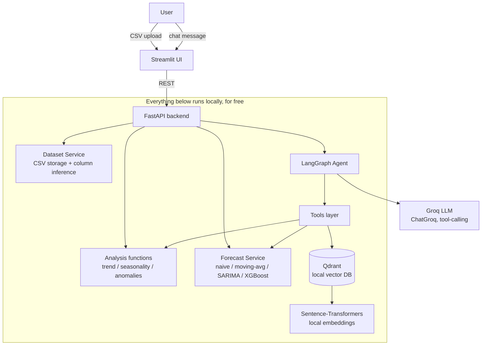
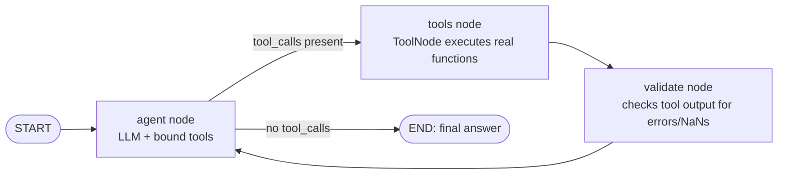

# ForecastGPT

A conversational AI assistant for time-series analysis and forecasting. Upload a CSV,
then chat with an agent that analyzes trend/seasonality, detects anomalies, generates
forecasts with real statistical/ML models, compares models, runs what-if scenarios, and
explains all of it in plain language — **without ever letting the LLM invent a number**.

Built as a learning project for **GenAI engineering + LangGraph + RAG + time-series
forecasting**, and designed to run **100% locally, for free**.

```
docker compose up
```

That's it. No OpenAI key, no paid vector DB, no paid hosting. The only external call is
to Groq's free-tier LLM API (swappable — see below).

---

## Table of contents

1. [Quick start](#quick-start)
2. [Architecture overview](#architecture-overview)
3. [Why each component exists](#why-each-component-exists)
4. [The LangGraph agent workflow, in detail](#the-langgraph-agent-workflow-in-detail)
5. [Why Qdrant / where RAG is actually used](#why-qdrant--where-rag-is-actually-used)
6. [How tool calling works here](#how-tool-calling-works-here)
7. [Forecasting vs. LLM generation](#forecasting-vs-llm-generation)
8. [How models are evaluated](#how-models-are-evaluated)
9. [Project structure](#project-structure)
10. [API reference](#api-reference)
11. [Example questions to ask the agent](#example-questions-to-ask-the-agent)
12. [Running tests](#running-tests)
13. [Troubleshooting](#troubleshooting)
14. [Extending this for a portfolio](#extending-this-for-a-portfolio)

---

## Quick start

### 1. Prerequisites

- Docker + Docker Compose
- A free Groq API key: https://console.groq.com/keys

### 2. Configure

```bash
cp .env.example .env
# then edit .env and paste your GROQ_API_KEY
```

### 3. Run everything

```bash
docker compose up --build
```

This starts three containers:
| Service | URL | What it is |
|-----------|------------------------------|------------|
| `qdrant` | http://localhost:6333/dashboard | Local vector DB (Docker image, no account needed) |
| `backend` | http://localhost:8000/docs | FastAPI + the LangGraph agent |
| `frontend`| http://localhost:8501 | Streamlit UI |

### 4. Try it

Open http://localhost:8501, upload `data/example_sales.csv` (included in this repo — two
years of synthetic daily sales data with trend, weekly seasonality, and a few injected
anomalies), and either click through the tabs or go straight to the **Chat** tab and ask:

> "Is there seasonality in this data, and what would you forecast for the next 30 days?"

### Running without Docker (local dev)

```bash
python -m venv venv && source venv/bin/activate
pip install -r requirements.txt

# Terminal 1: Qdrant (still via Docker — it's the one piece worth containerizing even in dev)
docker run -p 6333:6333 -v $(pwd)/qdrant_storage:/qdrant/storage qdrant/qdrant:v1.11.3

# Terminal 2: backend
cd backend && PYTHONPATH=. uvicorn app.main:app --reload --port 8000

# Terminal 3: frontend
cd frontend && streamlit run app.py
```

---

## Architecture overview



**Key architectural decision:** the LLM only ever sits at two points — deciding _which
tool to call_ and _turning tool output into a sentence_. Every actual number (a forecast
value, an RMSE, a slope, an anomaly score) is produced by pandas/numpy/statsmodels/
scikit-learn/xgboost and handed to the LLM as already-computed JSON. This is the single
most important design choice in the project and is enforced at the system-prompt level
(see `backend/app/agents/graph.py`).

---

## Why each component exists

| Component                                      | Why it's here                                                                                                                                                                                                                                                                                               |
| ---------------------------------------------- | ----------------------------------------------------------------------------------------------------------------------------------------------------------------------------------------------------------------------------------------------------------------------------------------------------------- |
| **FastAPI**                                    | Thin, typed, auto-documented (`/docs`) HTTP layer. Routes do almost no logic themselves — they call services/forecasting modules, so those modules are testable in complete isolation from the web framework (see `tests/test_forecasting.py`, which never imports FastAPI at all).                         |
| **LangGraph**                                  | Gives the agent an explicit, inspectable _graph_ of states (agent → tools → validate → agent) instead of an opaque prompt loop. You can point at `agents/graph.py` and explain exactly how the agent decides what to do next — this is the difference between "I called an LLM API" and "I built an agent." |
| **Groq**                                       | Free-tier hosted LLM inference, fast enough for a snappy chat UX. Deliberately abstracted behind `agents/llm.py::get_chat_model()` so swapping providers (e.g. a local Ollama model later) is a one-function change.                                                                                        |
| **Qdrant**                                     | The only piece of infrastructure dedicated purely to _semantic_ retrieval — used for conceptual questions and past-analysis recall, never for numeric results (see the RAG section below). Runs as a single Docker container, no cloud account.                                                             |
| **Sentence-Transformers (`all-MiniLM-L6-v2`)** | A small (~80MB), fast, free, local embedding model. No API calls, no per-request cost, works fully offline after the first download.                                                                                                                                                                        |
| **Pandas / NumPy**                             | The substrate everything else is built on: cleaning, resampling, feature engineering.                                                                                                                                                                                                                       |
| **statsmodels (SARIMA)**                       | The classical, statistically-grounded forecasting model. Chosen because it explicitly separates trend/seasonality/noise and produces real confidence intervals from the fitted model's error distribution — not a guess.                                                                                    |
| **XGBoost**                                    | A non-linear, feature-based alternative to SARIMA. Forces the project to demonstrate the "reframe time series as supervised learning" pattern (lag/rolling/calendar features), which is one of the most commonly asked-about techniques in applied ML interviews.                                           |
| **scikit-learn**                               | `IsolationForest` for anomaly detection, plus general utility (metrics, preprocessing patterns).                                                                                                                                                                                                            |
| **Plotly** (via Streamlit)                     | Interactive charts with hover tooltips and zoom — much more useful for exploring a forecast band than a static image.                                                                                                                                                                                       |
| **Docker Compose**                             | One command (`docker compose up`) brings up the vector DB, backend, and frontend together with correct networking — critical for the "must run locally for free" requirement to actually be _easy_, not just theoretically possible.                                                                        |

---

## The LangGraph agent workflow, in detail



State (`backend/app/agents/state.py`) is a single `TypedDict` threaded through every
node: the running message history, which dataset is loaded, a running log of every tool
call made (for transparency in the UI), and validation notes.

1. **`agent` node** — The LLM (via `ChatGroq`) is invoked with the full conversation
   plus a system prompt (see `SYSTEM_PROMPT` in `graph.py`) that lays down hard rules:
   never invent numbers, always call a tool first, use `search_knowledge_base` only for
   conceptual questions, and be honest about validation problems. The LLM decides _on
   its own_ — from the user's phrasing — whether it needs a tool, which one, and with
   what arguments. This is real tool selection, not a hand-coded intent classifier.
2. **`tools` node** — LangGraph's prebuilt `ToolNode` executes whatever the LLM asked
   for, against the actual Python functions in `agents/tools.py` (which themselves call
   `forecasting/*.py`). Results are appended to the conversation as `ToolMessage`s.
3. **`validate` node** — A deterministic (non-LLM) check: does any tool result contain
   an `"error"` field, zero rows, or other red flags? If so, a note is recorded and fed
   back into context so the agent can caveat its answer honestly instead of confidently
   describing broken numbers.
4. Control returns to **`agent`**, which now sees the tool output and either calls more
   tools (e.g., it just checked trend and now decides it also needs seasonality) or
   produces a final natural-language answer with no further tool calls, which ends the
   graph. The loop is hard-capped at 6 round trips (`MAX_STEPS`) so it always terminates.

### Why not just prompt-loop this in plain Python?

You could — but LangGraph gives you: (a) a state object with a merge strategy
(`add_messages`) instead of manual list-appending bugs, (b) a _named, inspectable_ graph
you can draw and reason about (this is what the diagram above literally is), and (c) a
clean seam to add more nodes later (e.g. a second validation pass, a human-approval
node, parallel tool fan-out) without restructuring a monolithic loop.

---

## Why Qdrant / where RAG is actually used

The most important thing to understand about this project's RAG design is **where it is
NOT used**: any question with a numeric answer (a forecast value, an RMSE, "how many
anomalies") always goes through a tool call to real Python, never through vector search.
Forcing numeric questions through embeddings would be strictly worse — slower, lossier,
and it would invite the LLM to paraphrase a retrieved chunk instead of reporting an exact
number.

Qdrant is used for exactly three things (see `backend/app/services/knowledge_base.py`
and `qdrant_service.py`):

1. **Forecasting-method documentation** — hand-written explanations of SARIMA vs.
   XGBoost vs. baselines, what MAE/RMSE/MAPE mean, why time-based splitting matters, etc.
   Seeded once at backend startup. A question like _"why would I use SARIMA instead of
   XGBoost here?"_ retrieves the relevant doc and the LLM explains it — instead of
   relying purely on the LLM's own (unverifiable) training-time knowledge.
2. **Dataset metadata** — every upload is embedded as a short summary ("Dataset 'sales.csv'
   uploaded with 730 rows, from 2023-01-01 to 2024-12-30..."), enabling semantic recall
   across multiple uploaded datasets later.
3. **Past analysis summaries** — a natural extension point (see
   [Extending this project](#extending-this-for-a-portfolio)) for storing a summary every
   time the agent runs a full analysis, so "what did we find last time?" can retrieve
   instead of recomputing.

Embeddings are produced entirely locally by `sentence-transformers/all-MiniLM-L6-v2`
(384-dim, cosine similarity) — there is no OpenAI embeddings call anywhere in this
codebase.

---

## How tool calling works here

`backend/app/agents/tools.py` defines nine `StructuredTool`s, each a thin wrapper around
a deterministic function:

| Tool                    | Wraps                                                                             |
| ----------------------- | --------------------------------------------------------------------------------- |
| `profile_dataset`       | `forecasting/analysis.py::profile_dataset`                                        |
| `analyze_trend`         | `forecasting/analysis.py::analyze_trend` (linear regression slope + R²)           |
| `analyze_seasonality`   | `forecasting/analysis.py::analyze_seasonality` (statsmodels `seasonal_decompose`) |
| `detect_anomalies`      | `forecasting/analysis.py::detect_anomalies` (rolling z-score or IsolationForest)  |
| `generate_forecast`     | `services/forecast_service.py::run_forecast` (any of the 4 models)                |
| `compare_models`        | `forecasting/model_selector.py::compare_models`                                   |
| `create_visualization`  | `services/visualization_service.py`                                               |
| `search_knowledge_base` | `services/qdrant_service.py::search` (RAG)                                        |
| `what_if_analysis`      | simplified scenario adjustment on the moving-average baseline                     |

Tools are built by a **factory function**, `build_tools(dataset_id)`, instead of being
plain module-level functions. This closure binds the _currently active dataset_ into
each tool at graph-invocation time, which means the LLM's tool-calling schema never
includes a `dataset_id` argument — so it can never accidentally hallucinate or mix up a
dataset ID. The API layer decides which dataset is "active" for a conversation; the LLM
only ever operates on "the currently uploaded dataset."

Tool descriptions (the `description=` strings) are what the LLM actually reads to decide
_when_ to call each one — they're written as precise, disambiguating explanations (e.g.
telling the LLM explicitly that `search_knowledge_base` is for concepts, not numbers).

---

## Forecasting vs. LLM generation

This is worth stating plainly because it's the crux of the whole project:

- An LLM predicting "next week's sales will be about 5,400" from a text description of
  a series is **pattern-completion over training data**, not a fitted statistical model.
  It has no access to your actual numbers, can't be validated, and will confidently
  produce a plausible-looking wrong answer.
- This project instead **fits models to your actual uploaded data** — SARIMA estimates
  its own coefficients from your series via maximum likelihood; XGBoost trains 200
  boosted trees on your lag/rolling/calendar features; the baselines compute literal
  means. The LLM is shown the _output_ of this fitting process (already-computed numbers)
  and asked only to phrase it in natural language.
- The system prompt in `graph.py` enforces this explicitly ("You NEVER invent numeric
  results... every number in your answer must come from a tool call") and the `validate`
  node is a second line of defense that flags malformed tool output before the agent's
  final explanation step.

---

## How the forecasting models are evaluated

`forecasting/preprocessing.py::time_based_split` holds out the **most recent** N periods
as a validation set — never a random split, since that would leak future data into
training and doesn't reflect how the model will actually be used (predicting values it
hasn't seen yet, in chronological order).

Three metrics (`forecasting/evaluation.py`), always computed on real numpy arrays:

- **MAE** (Mean Absolute Error) — average absolute error, same units as the data.
- **RMSE** (Root Mean Squared Error) — like MAE but penalizes large errors more heavily.
- **MAPE** (Mean Absolute Percentage Error) — error as a % of actual value; returned as
  `None` when the true values contain zeros (MAPE is mathematically undefined there,
  and the code says so rather than silently producing `inf`).

`forecasting/model_selector.py::compare_models` fits **all four** models (naive,
moving-average, SARIMA, XGBoost) on the same train/validation split and ranks them by
RMSE — this is what powers both `POST /forecast` with `compare_all=true` and the agent's
`compare_models` tool. If a model fails to fit (e.g. SARIMA on a tiny/degenerate series),
it's recorded with an `error` field and `rmse=inf` rather than crashing the whole
comparison.

---

## Project structure

```
forecastgpt/
├── backend/
│   └── app/
│       ├── main.py                 # FastAPI app, lifespan (seeds Qdrant KB on startup)
│       ├── api/
│       │   └── routes.py           # /upload /analyze /forecast /chat /dataset/{id} /health
│       ├── agents/
│       │   ├── state.py            # LangGraph AgentState TypedDict
│       │   ├── graph.py            # the agent graph: agent -> tools -> validate -> agent
│       │   ├── tools.py            # 9 StructuredTools wrapping forecasting/analysis fns
│       │   └── llm.py              # LLM provider abstraction (Groq today)
│       ├── forecasting/
│       │   ├── preprocessing.py    # time-based split, lag/rolling/calendar features
│       │   ├── baselines.py        # naive, moving average
│       │   ├── statsmodels_forecast.py  # SARIMA + auto seasonal-period guess
│       │   ├── xgboost_forecast.py # recursive multi-step XGBoost forecasting
│       │   ├── analysis.py         # profile, trend, seasonality, anomaly detection
│       │   ├── evaluation.py       # MAE / RMSE / MAPE
│       │   └── model_selector.py   # fit+compare all models, pick the best
│       ├── services/
│       │   ├── dataset_service.py       # CSV ingestion, column inference, registry
│       │   ├── forecast_service.py      # forward forecast + confidence bands
│       │   ├── chat_service.py          # per-conversation history + graph invocation
│       │   ├── embedding_service.py     # local Sentence-Transformers wrapper
│       │   ├── qdrant_service.py        # Qdrant client, upsert/search
│       │   ├── knowledge_base.py        # seed docs for RAG
│       │   └── visualization_service.py # chart-ready JSON specs
│       ├── models/
│       │   └── schemas.py          # every Pydantic request/response model
│       └── core/
│           ├── config.py           # Settings (env-driven, cached)
│           └── logging_config.py   # loguru setup
├── frontend/
│   └── app.py                      # Streamlit: upload / overview / charts / chat
├── tests/
│   ├── test_forecasting.py         # pure-function tests (no FastAPI/Qdrant needed)
│   └── test_api.py                 # FastAPI TestClient integration tests
├── data/
│   └── example_sales.csv           # 2 years of synthetic daily sales (trend+seasonality+anomalies)
├── docker-compose.yml
├── Dockerfile.backend
├── Dockerfile.frontend
├── requirements.txt
├── .env.example
└── README.md
```

---

## API reference

Full interactive docs at `http://localhost:8000/docs` once the backend is running.
Summary:

| Method | Path                    | Purpose                                                    |
| ------ | ----------------------- | ---------------------------------------------------------- |
| `GET`  | `/health`               | Backend + Qdrant connectivity status                       |
| `POST` | `/upload`               | Upload a CSV (multipart `file`); infers date/value columns |
| `GET`  | `/dataset/{dataset_id}` | Metadata for a previously uploaded dataset                 |
| `POST` | `/analyze`              | Run profile/trend/seasonality/anomaly checks               |
| `POST` | `/forecast`             | Forecast with a chosen model; optional `compare_all`       |
| `POST` | `/chat`                 | Talk to the LangGraph agent                                |

---

## Example questions to ask the agent

- "What's in this dataset — give me a quick profile."
- "Is there a trend? Is it going up or down?"
- "Is there seasonality, and what's the period?"
- "Are there any anomalies in this data? Use isolation forest."
- "Forecast the next 30 days with SARIMA."
- "Compare all the forecasting models and tell me which one you'd recommend."
- "What's the difference between SARIMA and XGBoost for this kind of data?"
- "Why is MAPE sometimes undefined?"
- "What would the forecast look like if demand grew 15% faster than the recent trend?"
- "Explain why time-based splitting matters instead of a random split."

---

## Running tests

```bash
pip install -r requirements.txt
PYTHONPATH=backend pytest tests/ -v
```

`tests/test_forecasting.py` covers the pure forecasting/analysis math (10 tests) and
needs no network access at all. `tests/test_api.py` covers the FastAPI layer end-to-end
(upload → analyze → forecast) using FastAPI's `TestClient` (4 tests) and degrades
gracefully if Qdrant isn't running (dataset-metadata indexing is wrapped in a try/except
so it doesn't block the upload response). `/chat` is intentionally excluded from
automated tests since it requires a live Groq API key — exercise it manually via the
Streamlit UI or `curl`.

---

## Troubleshooting

- **"GROQ_API_KEY is not set"** — copy `.env.example` to `.env` and fill in a real key
  from https://console.groq.com/keys.
- **Qdrant shows 🔴 not connected in the sidebar** — make sure the `qdrant` container is
  up (`docker compose ps`) and reachable on port 6333; on first run, allow ~30s for it to
  become healthy before the backend's startup seeding kicks in.
- **First chat message is slow** — the Sentence-Transformers model downloads (~80MB) on
  first use inside the backend container; subsequent runs are fast.
- **SARIMA convergence warnings** — statsmodels sometimes warns about MLE convergence on
  short/noisy series. It's non-fatal; the forecast still returns. Try a longer horizon,
  more history, or a different model if the numbers look unstable.

---

## Extending this for a portfolio

- **Swap Groq for a fully local LLM** — add an `ollama` branch to `agents/llm.py::get_chat_model()`
  and run e.g. Llama 3.1 or Qwen2.5 locally via Ollama; zero API calls at all.
- **Persist past analysis summaries to Qdrant** — after every `/analyze` or agent-driven
  analysis, embed a natural-language summary and store it (`doc_type="analysis_report"`),
  so "what did we learn about dataset X last week?" becomes a real retrieval case.
  This directly extends the pattern already used for dataset-metadata indexing in `routes.py`.
- **Add streaming responses** — LangGraph and `ChatGroq` both support streaming; wiring
  `POST /chat` to Server-Sent Events would make the Streamlit chat feel more responsive.
- **Add a proper database** — swap the JSON registry in `dataset_service.py` for
  SQLite/Postgres without touching any calling code (it's isolated behind
  `DatasetService`).
- **Add more forecasting models** — Prophet, LightGBM, or a simple LSTM would slot into
  `forecasting/` and `model_selector.MODEL_FUNCS` with no other code changes.
- **Multi-series support** — extend `DatasetService` to handle wide/long-format CSVs with
  multiple series (e.g. per-store sales) and add a `series_id` dimension throughout.
- **Human-in-the-loop node** — add a LangGraph node that pauses before a high-impact
  action (e.g. before running an expensive model comparison) for user confirmation,
  demonstrating LangGraph's interrupt/checkpoint features.
- **Deploy for free** — Streamlit Community Cloud + a free-tier Qdrant Cloud cluster +
  Groq keeps the entire stack at $0 even outside your laptop.
